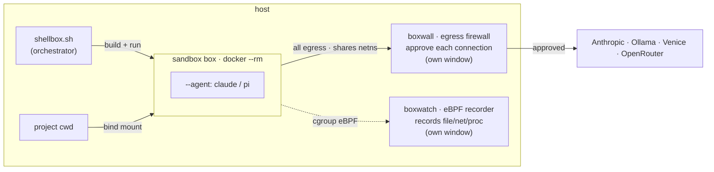

# shellbox

A tiny wrapper that runs an ephemeral Docker shell with the current directory mounted inside, with an interactive network firewall and eBPF monitoring of file, network and process activity. Built for [Claude Code](https://docs.anthropic.com/en/docs/claude-code) and [pi](https://pi.dev).

- Throwaway container with the project at `/home/dev/work`
- Claude Code or pi, Python 3 and common dev tools; brings over the agent login and settings, telemetry off
- No root and a cap on processes, with optional gVisor (`--runsc`)
- Control access to services running on the local host
- `--boxwall` asks for approval of each outbound connection (deny|allow once|forever|until quit)
- `--allow-install` provides `sudo` and `apt` inside the box
- `--boxwatch` records file, network and process activity in the box via eBPF




## Requirements

- Docker Desktop / Engine (25.0+ for multiple `--network` flags; **28+ for `--boxwall`**)
- For Claude, a Claude login on the host. `~/.claude` is copied into the box; on macOS the login lives in the Keychain, so run `/login` once in each box.
- For pi, the `~/.pi/agent` config or a [model provider](#agent) key.

## Install

Clone the repo and add it to `$PATH`. Keep `agents/` in the same directory as `shellbox.sh`.

## Usage

```bash
shellbox.sh                                       # interactive shell in the current dir
shellbox.sh -- python3 my_script.py               # run a command instead of a shell
shellbox.sh -p 8000:8000 -- python3 -m http.server 8000
shellbox.sh --help
```

First run builds the image; container removed on exit. Use `--rebuild` to update the agent.

## agent

`--agent claude` (the default) installs Claude Code with the settings and login from `~/.claude`. `--agent pi` installs [pi](https://pi.dev) with the config from `~/.pi/agent`. Each box gets only the chosen agent.

pi works with these model providers. Export the variable on the host, and the models from that provider show up in the `/model` list in pi.

| Variable | Models |
|---|---|
| `OLLAMA_API_KEY` | [Ollama Cloud](agents/pi/extensions/ollama.ts) |
| `OLLAMA_LAN_URL` | An Ollama server on the local network, e.g. `http://192.168.1.50:11434` (start it with `OLLAMA_HOST=0.0.0.0`) |
| `VENICE_API_KEY` | [Venice](agents/pi/extensions/venice.ts) private models |
| `OPENROUTER_API_KEY` | OpenRouter (built into pi) |

pi starts on an Ollama Cloud model if that key is set, or on a Venice model if only the Venice key is. A default set in pi always wins.

## boxwall

boxwall is a firewall for the box. Run it in a second window, and it asks about every new outbound connection.

```bash
./boxwall/boxwall.sh --name proj-a   # window 1
shellbox.sh --boxwall proj-a         # window 2: all egress goes through it
```

More in [boxwall/README.md](boxwall/README.md).

## boxwatch

boxwatch runs in a separate container and records file, network and process activity in the box to a log on the host. The box cannot reach or change that log. It does have [limits](boxwatch/README.md#limits).

```bash
./boxwatch/boxwatch.sh --name proj-a   # window 1: start the watcher
shellbox.sh --boxwatch proj-a          # window 2: activity recorded
```

More in [boxwatch/README.md](boxwatch/README.md).

## Local host egress block

The box cannot reach services running on the host without `--allow-local-host`.

## allow-install

`--allow-install` gives the agent `sudo` and `apt` inside the box. It still cannot reach the host outside the project folder or get around `--boxwall`, and anything it installs disappears when the box exits.

```bash
shellbox.sh --allow-install                   # sudo/apt work; start the agent manually
shellbox.sh --allow-install --boxwall proj-a  # + gate every outbound connection by hand
```
